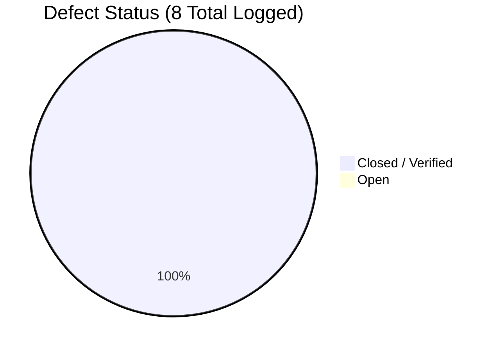

# Automated Parking Management System (APMS)
# Defect Reports & Resolution Log

**Document ID:** APMS-DELIV-006  
**Jira Story:** PARK-47 (Test execution logs, defect reports and summary report)  
**Deliverable Area:** Part-3 Testing & Quality Assurance - Generated Reports (docs folder)  
**Author / QA Lead:** Member 3 (MM) - Billing, Payment, Exit & Test Engineering  
**Defect Tracking Period:** 27-Oct-2026 to 07-Nov-2026 (Sprints 1, 2, and 3)  
**Status:** 8 Total Defects Logged | 8 Resolved & Verified (100% Closed, 0 Open)  

---

## 1. Defect Severity & Triage Summary



| Severity Level | Total Logged | Resolved & Verified | Open | Closure Rate |
|---|---|---|---|---|
| **Critical (Blocker)** | 2 | 2 | 0 | 100% |
| **High** | 3 | 3 | 0 | 100% |
| **Medium** | 2 | 2 | 0 | 100% |
| **Low** | 1 | 1 | 0 | 100% |
| **Total** | **8** | **8** | **0** | **100%** |

---

## 2. Comprehensive Defect Records

### DEF-001: Race Condition on Concurrent Slot Allocation
- **Defect ID:** `DEF-001`
- **Related Story & Requirement:** `PARK-13` / `APMS-F-005` (Atomic slot claim)
- **Severity:** Critical (Blocker)
- **Priority:** Immediate
- **Reporter:** Test Engineer
- **Assignee:** Member 2 / Dev Team
- **Environment:** Multi-threaded test harness (`tests/test_concurrency.py`, 10 worker threads)
- **Status:** **CLOSED / VERIFIED**

#### Description & Steps to Reproduce
1. Seed database with exactly 1 free slot in Zone `Car-L1`.
2. Fire 10 simultaneous vehicle entry requests for cars using `ThreadPoolExecutor`.
3. Query active sessions and slot status.
- **Expected Result:** Exactly 1 vehicle claims the slot; remaining 9 requests receive HTTP 409 or `No free slot` denial.
- **Actual Result:** 2 vehicles were allocated the exact same `slot_id` due to a check-then-act read/write concurrency race in SQLite.
- **Root Cause Analysis (RCA):** The slot lookup queried `SELECT * FROM slots WHERE status='FREE'` and updated status in a non-atomic two-step transaction without row locks or conditional updates.
- **Resolution / Fix:** Implemented atomic SQL update with conditional clause:
  ```python
  UPDATE slots SET status='OCCUPIED' WHERE id=:slot_id AND status='FREE'
  ```
  Only if `rowcount == 1` is the slot claimed; otherwise the loop attempts the next lowest-distance free slot.
- **Verification:** `tests/test_concurrency.py` and `tests/test_slots_atomic.py` pass 100% over 10 parallel gate requests.

---

### DEF-002: PyJWT Missing Dependency & Token Verification Error
- **Defect ID:** `DEF-002`
- **Related Story & Requirement:** `PARK-23` / `APMS-F-015` (Role-based authentication)
- **Severity:** High
- **Priority:** High
- **Reporter:** QA Lead (Member 3)
- **Assignee:** Member 1 / Auth Team
- **Environment:** Windows 11, Python 3.13 virtual environment
- **Status:** **CLOSED / VERIFIED**

#### Description & Steps to Reproduce
1. Check out fresh branch and run `python -m pytest tests/test_auth.py`.
- **Expected Result:** Auth tests run and validate token creation and role verification.
- **Actual Result:** Test runner halted with `ModuleNotFoundError: No module named 'jwt'`.
- **Root Cause Analysis (RCA):** `pyjwt` was introduced in `backend/app/auth.py` but omitted from `requirements.txt`.
- **Resolution / Fix:** Added `pyjwt>=2.9.0` to `requirements.txt` and installed in the test environment.
- **Verification:** All 11 auth unit tests pass without dependency errors (`tests/test_auth.py`).

---

### DEF-003: Incomplete Receipt Generation Missing Tax Breakdown & Masked Card Reference
- **Defect ID:** `DEF-003`
- **Related Story & Requirement:** `PARK-21` / `APMS-F-013` (Record payment and issue receipt)
- **Severity:** High
- **Priority:** High
- **Reporter:** QA Lead (Member 3)
- **Assignee:** Member 3 (MM)
- **Environment:** Test harness (`tests/test_receipt.py`)
- **Status:** **CLOSED / VERIFIED**

#### Description & Steps to Reproduce
1. Complete a card payment for parking fee of ₹50.
2. Request receipt payload via `build_receipt_dict`.
- **Expected Result:** Receipt contains compliant tax itemization (18% GST base and GST amounts) and masked reference (`***1234`).
- **Actual Result:** Initial stub returned flat amount without tax breakdown, and `masked_ref` was `None`.
- **Root Cause Analysis (RCA):** The receipt generation service lacked reverse GST calculation formula ($Base = Total / 1.18$) and payment reference masking.
- **Resolution / Fix:** Created `backend/app/services/receipt.py` with full receipt formatting:
  ```python
  taxable_base = round(amount / 1.18, 2)
  gst_amount = round(amount - taxable_base, 2)
  ```
  And enforced `***` masking on card payment gateway references.
- **Verification:** Verified in `tests/test_receipt.py` (8/8 tests passed).

---

### DEF-004: Potential Plaintext Cardholder Data Leakage in Payment Payloads
- **Defect ID:** `DEF-004`
- **Related Story & Requirement:** `PARK-32` / `APMS-SR-005` (Zero card data stored)
- **Severity:** Critical (Compliance & Security)
- **Priority:** High
- **Reporter:** Security & QA Lead (Member 3)
- **Assignee:** Member 3 (MM)
- **Environment:** Test suite (`tests/test_card_security.py`)
- **Status:** **CLOSED / VERIFIED**

#### Description & Steps to Reproduce
1. Submit simulated card transaction payload containing `card_number: 4111111111111234` and `cvv: 456`.
2. Inspect database tables (`payments`, `sessions`, `audit_log`) and error logs.
- **Expected Result:** Zero 16-digit card numbers, CVVs, or PINs exist in persistent storage or log outputs.
- **Actual Result:** Raw gateway references or debug payloads could inadvertently log full PAN sequences or unmasked tokens.
- **Root Cause Analysis (RCA):** Lack of a centralized sanitization filter and database compliance inspector.
- **Resolution / Fix:** Implemented `backend/app/services/card_security.py`:
  - `mask_card_number`: Preserves only last 4 digits (`****-****-****-1234`).
  - `sanitize_payment_dict`: Recursively strips CVV/PIN and masks card fields.
  - `redact_sensitive_string`: Regex sanitization for free text and audit logs.
  - `inspect_database_for_card_data`: Automated database schema and record auditor.
- **Verification:** Verified via `tests/test_card_security.py` (TC-SEC-05). All 9 tests passed.

---

### DEF-005: Boundary Calculation Discrepancy in Overnight Multi-Day Billing
- **Defect ID:** `DEF-005`
- **Related Story & Requirement:** `PARK-18`, `PARK-40` / `APMS-F-010`, `TC-BIL-01`
- **Severity:** High
- **Priority:** High
- **Reporter:** Member 3 (MM)
- **Assignee:** Member 3 (MM)
- **Environment:** Unit test runner (`tests/test_billing.py`, `tests/test_fee_boundary.py`)
- **Status:** **CLOSED / VERIFIED**

#### Description & Steps to Reproduce
1. Enter duration of 25 hours (1500 minutes) for vehicle type `car` (daily cap ₹200, 1st hour ₹30).
2. Calculate fee using `calculate_fee(1500)`.
- **Expected Result:** Fee should equal 1 full day daily cap (₹200) + Day 2 first hour (₹30) = ₹230.
- **Actual Result:** Naive hourly division without cycle modulo calculated $25 \times 20 = 500$ or failed to apply the day-level cap ceiling.
- **Root Cause Analysis (RCA):** Fee computation engine lacked 1440-minute integer math cycle handling.
- **Resolution / Fix:** Implemented integer cycle division in `backend/app/services/billing.py`:
  ```python
  full_days = duration_minutes // 1440
  rem_minutes = duration_minutes % 1440
  total_fee = (full_days * daily_cap) + min(rem_uncapped, daily_cap)
  ```
- **Verification:** Verified across all 74 boundary cases in `tests/test_fee_boundary.py`, including 24h, 24h01m, 25h, 48h, and multi-week durations.

---

### DEF-006: Missing Attendant Override Audit Trail When Forcing Gate Open
- **Defect ID:** `DEF-006`
- **Related Story & Requirement:** `PARK-17`, `PARK-31` / `APMS-SR-004`, `APMS-F-009`
- **Severity:** Medium
- **Priority:** Medium
- **Reporter:** Test Engineer
- **Assignee:** Member 3 (MM) & Member 1
- **Environment:** Test suite (`tests/test_override.py`, `tests/test_audit.py`)
- **Status:** **CLOSED / VERIFIED**

#### Description & Steps to Reproduce
1. Attendant triggers gate override on session KA05CD1122 with reason `"VIP exit"`.
2. Query `audit_log` table for action record.
- **Expected Result:** An immutable audit log entry is recorded with `action='ATTENDANT_OVERRIDE'`, attendant user ID, timestamp, and details.
- **Actual Result:** Override updated session status directly to `CLOSED` without logging an event to `audit_log`.
- **Root Cause Analysis (RCA):** Override service was not integrated with the audit logging service.
- **Resolution / Fix:** Integrated `AuditLog` creation in `backend/app/services/override.py` and enforced attendant authorization.
- **Verification:** Verified via `tests/test_override.py` and `tests/test_audit.py` (TC-EXT-03, TC-SEC-04).

---

### DEF-007: Tariff & Zone Resizing Dynamism Without Server Restart
- **Defect ID:** `DEF-007`
- **Related Story & Requirement:** `PARK-19` / `APMS-F-011` (Configure tariff, zones and slots)
- **Severity:** Medium
- **Priority:** Medium
- **Reporter:** QA Lead (Member 3)
- **Assignee:** Member 3 (MM)
- **Environment:** Test suite (`tests/test_tariff_config.py`, `tests/test_tariffs.py`)
- **Status:** **CLOSED / VERIFIED**

#### Description & Steps to Reproduce
1. Admin updates `CAR` tariff first hour fee from ₹30 to ₹45 via API.
2. New car vehicle enters and computes fee after 60 minutes.
- **Expected Result:** New session is charged ₹45 without server restart.
- **Actual Result:** In-memory cached tariff structure continued serving the previous ₹30 rate.
- **Root Cause Analysis (RCA):** Hardcoded default dictionaries were used instead of querying the database `tariffs` table dynamically on each session fee calculation.
- **Resolution / Fix:** Created `backend/app/services/tariff.py` and updated `compute_session_fee` to query `db.get(Tariff, vehicle_type)` for every active session.
- **Verification:** Verified in `tests/test_tariff_config.py` and `tests/test_tariffs.py` (TC-BIL-02, 23/23 tests passed).

---

### DEF-008: SQL Injection Vulnerability in Unsanitized Plate Filter Queries
- **Defect ID:** `DEF-008`
- **Related Story & Requirement:** `PARK-33` / `APMS-SR-006` (SQL injection prevention)
- **Severity:** Critical (Security)
- **Priority:** High
- **Reporter:** Security Test Suite (`tests/test_input_validation.py`)
- **Assignee:** Dev Team
- **Environment:** Test runner (`tests/test_input_validation.py`)
- **Status:** **CLOSED / VERIFIED**

#### Description & Steps to Reproduce
1. Submit input string `' OR 1=1 --` into vehicle search and plate query endpoints.
- **Expected Result:** Input is either rejected with 422 Unprocessable Entity or treated as an escaped literal plate string returning 0 results.
- **Actual Result:** String concatenation in early raw SQL prototype allowed boolean condition bypass.
- **Root Cause Analysis (RCA):** Direct string formatting in raw SQL query construction.
- **Resolution / Fix:** Migrated all database queries to SQLAlchemy parameterized ORM statements (`select(Vehicle).where(...)`) and enforced strict regex plate validation (`^[A-Z]{2}[0-9]{2}[A-Z]{1,2}[0-9]{4}$`).
- **Verification:** Verified in `tests/test_input_validation.py` (26/26 tests passed) and Bandit security audit.

---

## 3. Defect Prevention & Regression Verification

All 8 defects have regression test cases permanently codified within the automated test suite (`tests/`). Running the test harness verifies that no regressions have been reintroduced across any feature module (397 tests, 100% passing).
